# Overview

## Platform Introduction

[ImmunoFusion](https://oncoharmony-network.github.io/ImmunoFusion/) is an interactive web platform for exploring RNA-seq–derived gene fusions in cancer, with a focus on their associations with the tumor microenvironment (TME) and responses to immune checkpoint blockade (ICB). It integrates fusion calls from large treatment-naïve cohorts and multiple ICB cohorts, and links them to rich clinical and TME signatures.

The platform is designed to help you:

- Explore the **pan-cancer landscape** of RNA-derived gene fusions.  
- Examine associations between fusions and **TME, tumor-intrinsic, and metabolic signatures**.  
- Assess **fusion co-occurrence/exclusivity** and compare **fusion-positive vs. fusion-negative** groups.
- Investigate how specific fusions relate to **survival outcomes** in treatment-naïve and ICB-treated cohorts.  

Please cite the ImmunoFusion paper if you use results from this platform in your work.

## Data Overview

ImmunoFusion is the largest cancer fusion gene database, integrating 78 cohorts, 20,995 samples, and 98,281 fusion calls (76,803 unique Fusion IDs), including data from TCGA, TARGET, and CPTAC.

**Core Data Metrics:**

- **Cohorts**: 78 (28 ICB / 50 non-ICB)
- **Samples**: 20,995 (4,671 ICB / 16,324 non-ICB: 14,449 tumor, 68 cell-line, 1,807 normal)
- **Fusion calls**: 98,281 records (12,750 ICB / 85,531 non-ICB); 76,803 unique Fusion IDs
- **Genes**: 23,565 (9,600+ ICB / 22,400+ non-ICB)
- **Gene Pairs**: 66,895 (10,200+ ICB / 57,800+ non-ICB)

The **Data Summary** module provides macro-level statistical views of cohorts and samples, including cohort characteristics (cancer type distribution, IO vs non-IO composition, sex ratio, treatment type and response distribution) and fusion profiles (fusion type and sample type distributions). Users can quickly grasp the overall dataset composition through this module.

## Citation and Disclaimer

This platform is for research purposes only. It does not collect personal information. Clinical use is at your own risk.

---

# Data Modules

## Fusion Module 

The Fusion module is the entry point for inspecting individual fusion events and their basic characteristics.

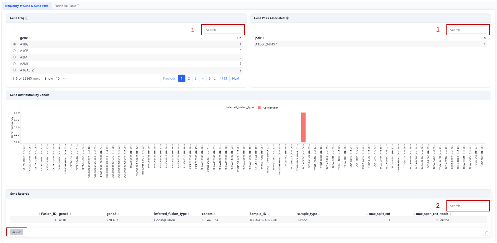{#fig-flow width=100%}

**Steps:**

1. Select gene (optional) or gene pairs (optional);
2. Filter by Gene, Sample_ID, Fusion_ID, etc.

**Outputs:**

- Browse specific fusions and view the distribution of different fusion types across the cohort in the middle panel;
- Download fusion summary tables as CSV files.

The **Gene Freq** and **Gene Pairs Associated** tables are a cached database-wide reference index and do not change with the global filters. The gene distribution, gene records, Fusion Full Table, and drill-down are recomputed from the globally filtered call set. `n` in the frequency index counts distinct fusion calls containing the gene or pair (a SameGene call is counted once).

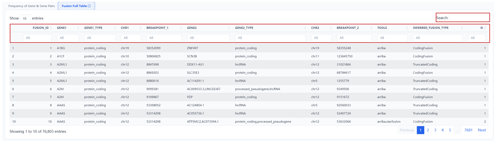{#fig-flow width=100%}

A searchable summary of all fusion events. Supports filtering by gene, fusion type, detection tool, etc. 

## Cohort Module 

The Cohort module provides an overview of all cohorts and datasets in ImmunoFusion.

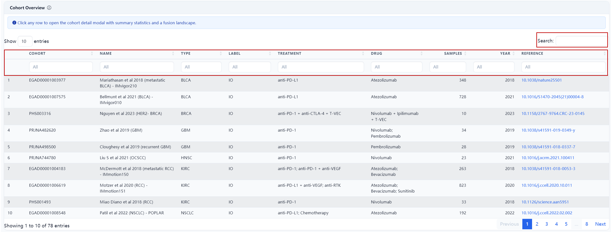{#fig-flow width=100%}

**Displayed Fields:** ID, name, cancer type, treatment/drug details, sample size, publication year/DOI, therapeutic label (e.g., IO), etc.

**Operation:** Search and filter the cohort list using the main search bar or individual column filters.

**Cohort Details**: Click any cohort row to open a detail modal with the following content:

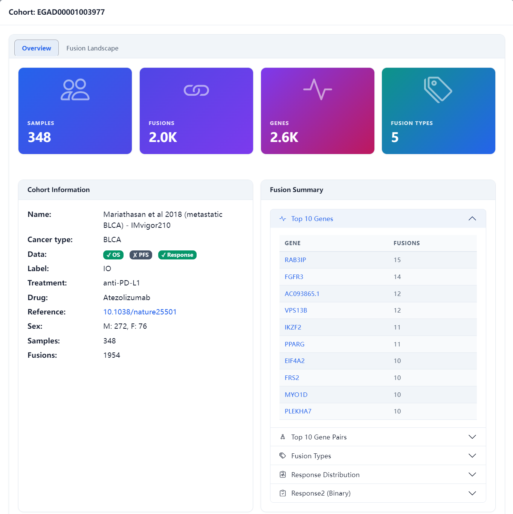{#fig-flow width=70%}

- **Overview**: sample size, total fusions, top fusion genes/gene pairs, fusion type distribution, and response distribution;

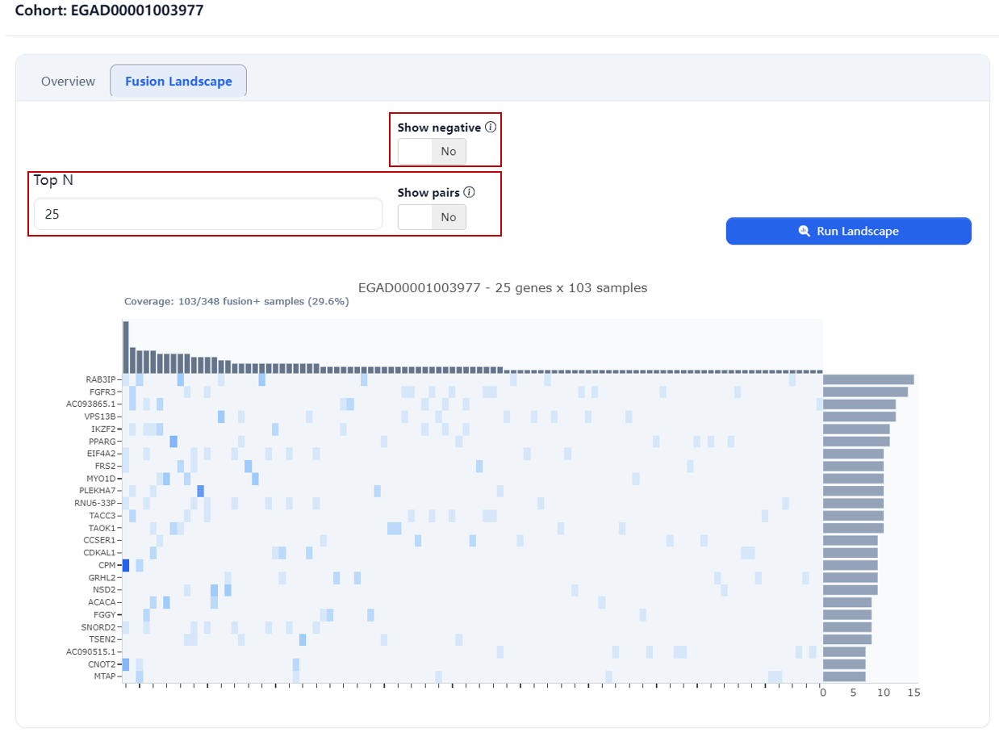{#fig-flow width=80%}

- **Fusion Landscape**: an OncoPrint of the cohort showing fusion event distribution across samples for the Top N genes or gene pairs (toggle “Show pairs”); coverage is reported relative to the analysed samples.

---

# Analysis Modules

The Analysis module consists of several sub-modules, all sharing a unified layout: Analysis controls on the left (cohorts, genes, endpoints, signatures) and Results on the right (interactive plots with export options).

**Export Options**: All analysis modules support chart exports (HTML) and data exports (CSV). Export buttons are located in the results panel of each module.

**Global Filters**: The global filters (cohort groups/cohorts, ICB treatment status, pre-treatment status, sample type, fusion type, detection tool, Score, genes, Fusion IDs, and split/span thresholds) define the analysis population. A patient is Fusion+ when any of their samples carries at least one fusion passing **all** active filters. An empty selection is equivalent to selecting everything. Treatment-status filters apply within ICB cohorts only; non-ICB cohorts are unaffected. A compact context bar at the top of every filter-aware page summarizes the active selections (not the effective post-filter counts, which are reported in each panel). Home, Data Summary, and the Cohort overview describe the full database and are independent of these filters; the Fusion page's gene/pair frequency index is also a database-wide reference, while its records, distribution, and tables are filter-aware.

## Distribution 

Evaluate the distribution characteristics of fusion genes across selected cohorts, generating fusion frequency plots, genome-wide breakpoint localization maps (Circos + Lollipop), and multi-dimensional composition charts. This module contains three sub-tabs: Frequency, Localization, and Composition.

### Frequency

Display the distribution of fusion-gene/gene-pair frequencies across the selected cohort(s). Each histogram unit is one gene/pair **in one cohort**, counted as the number of unique samples carrying it in that cohort.

**Steps:**

1. Select one or multiple cohort IDs and analysis type (Gene / Gene Pair);
2. Select plot type:
   - **Fusion frequency**: X-axis is the number of unique samples carrying the gene/pair in a cohort.
   - **Sample proportion**: X-axis is that count divided by the number of clinical samples analysed in the cohort (not by fusion-positive samples).
3. Optional: restrict to specific genes/pairs and/or mark one gene/pair;
   - The marker draws a **single** red reference line at the marked target's highest per-cohort value; the peak cohort and observed range are shown beneath the plot. This avoids drawing one line per cohort.
4. Click Run.

**Outputs:**

- Frequency histogram: Y-axis is the number of gene/pair–cohort units in each frequency bin; bars are drawn on a log10 scale from 1 upward;
- Marker note: peak cohort and range for the marked target;
- Data table: `Gene/Pair`, `Cohort`, and `Samples` (frequency mode) or `Proportion` (sample-proportion mode); downloadable as CSV.

All three Distribution panels (Frequency, Localization, Composition) recompute on **Run** from the globally filtered call set; no cached distribution is displayed. Page-level cohort and gene selectors narrow the data further.

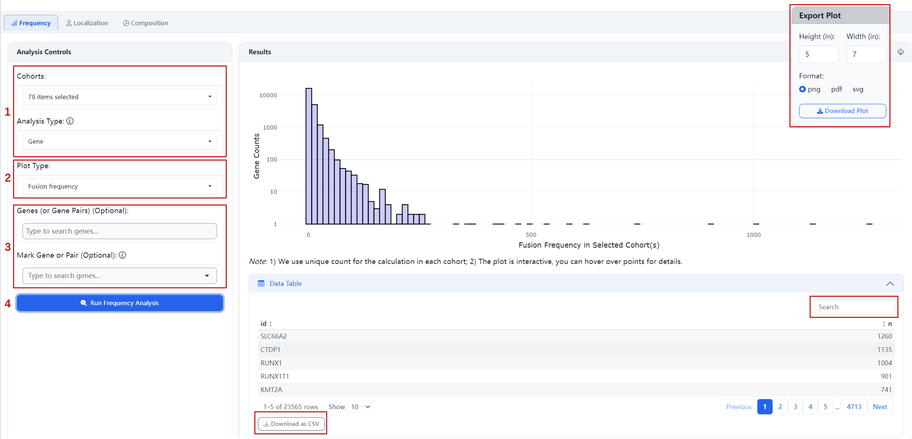{#fig-flow width=100%}

### Localization

Display genome-wide distribution of fusion breakpoints. Includes two visualization views:

#### Ideogram

Show genome-wide fusion breakpoint density.

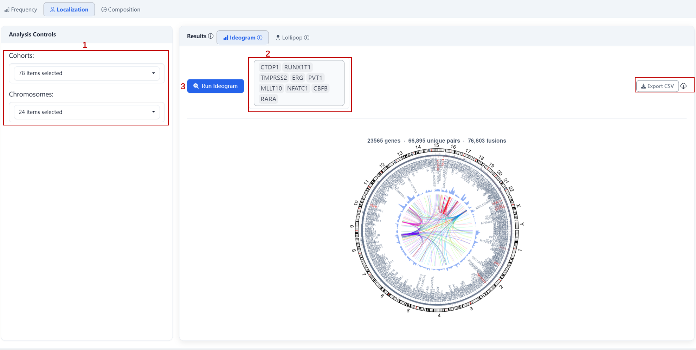{#fig-flow width=100%}
**Steps:**

1. Select cohorts (and optionally filter by chromosomes, all 24 by default);
2. Optional: mark specific genes to overlay fusion partner links;
3. Click Run.

**Outputs:**

- Circos plot: blue heatmap indicates breakpoint density; overlaid links show fusion partners for marked genes;
- Data source: filtered fusion calls aggregated by chromosome position.

#### Lollipop

ProteinPaint-style single-gene view showing fusion breakpoint distribution within a specific gene.

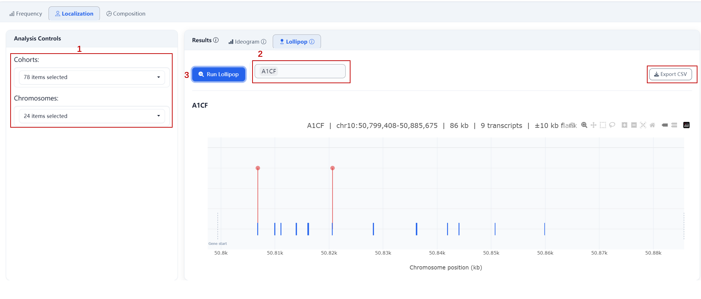{#fig-flow width=100%}

**Steps:**

1. Select cohorts (and optionally filter by chromosomes, all 24 by default);
2. Select target gene name;
3. Click Run.

**Outputs:**

- Gene structure diagram: blue rectangles represent CDS/exons (HG38 BED-based);
- Red circles: intragenic fusion breakpoints; circle size scales with breakpoint count;
- Orange markers: regulatory/distal breakpoints (flanking ±10% gene length);
- Hover for breakpoint details.

### Composition

Display the categorical breakdown of fusion events across multiple dimensions.

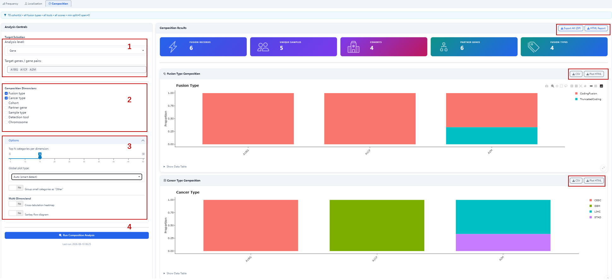{#fig-flow width=100%}

**Steps:**

1. Select analysis level (Gene/ Gene Pair) and target genes/gene pairs (e.g., A1BG, A1CF, A2M);
2. Select composition dimensions: Fusion Type, Cancer Type, Cohort, Partner Gene, Sample Type, Detection Tool, Chromosome (multiple selection allowed);
3. Adjust optional parameters:
   - Top N categories per dimension;
   - Global plot type: Auto, stacked/horizontal bar, Donut/Sunburst, dot, heatmap, or treemap; group small categories as "Other";
   - Multi-Dimensional: enable cross-tabulation heatmap or a target → first-dimension flow diagram;
4. Click Run Composition Analysis.

**Outputs:**

- Composition charts: fusion-event breakdowns across selected dimensions; each series represents a target gene/pair, with color-coded category proportions (e.g., fusion types);
- Per-target counts treat each selected gene independently (a call carrying two selected genes counts once for each), and comma-separated gene lists are expanded so `A,B::C` contributes to both `A::C` and `B::C`;
- Optional multi-dimensional views: cross-tabulation heatmap or flow diagram (target → first selected dimension).

## Comparison

Evaluate associations between fusion events and tumor microenvironment (TME) or IOBR immune signatures, generating box plots comparing feature scores between Fusion+ and Fusion− groups along with statistical test p-values.

This module offers two analysis modes:

- **TME**: compare cell-type abundance by fusion status;
- **IOBR Signature**: compare immune signature scores by fusion status.

The comparison unit can be **Samples** or **Patients**. In sample mode, every sample is a data point and Fusion+ is defined by the globally filtered call set (a sample is Fusion+ when it carries at least one fusion passing all active filters); multiple samples from one patient are not independent. In patient mode, the selected feature is averaged across each patient's samples and a patient is Fusion+ when any sample is Fusion+; this removes within-patient pseudoreplication. Each feature needs at least two non-missing observations in both fusion groups; otherwise the panel reports that the feature is not testable.

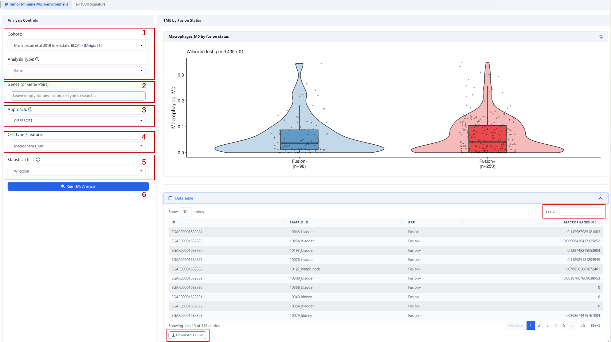{#fig-flow width=100%}

**Steps:**

1. Select target cohort and analysis type (Gene / Gene Pair);
2. Enter target gene/gene pair name(s) (leave empty to use all detected fusions);
3. Select analysis approach
4. Select cell type / feature (e.g., Macrophages_M0, APM);
5. Select statistical test (e.g., Wilcoxon);
6. Click Run.

**Outputs:**

- Box plot: displays feature abundance distribution between Fusion+ and Fusion− groups;
- Statistical results: Wilcoxon test p-value indicating significance between groups;
- Data table: includes sample ID, group label, and feature values; supports search and pagination.

## Association

Explore associations between gene fusions and molecular features, clinical response, and pairwise gene-fusion co-occurrence. This module contains three sub-tabs: Correlation, Response, and Gene Co-occurrence. Correlation, Response, and Gene Co-occurrence use the **patient** as the analysis unit (a patient is Fusion+ when any of their samples carries the relevant fusion), whereas the TME/Signature comparison above uses samples.

### Correlation

Evaluate the correlation between fusion count and TME/signature features at the patient level.

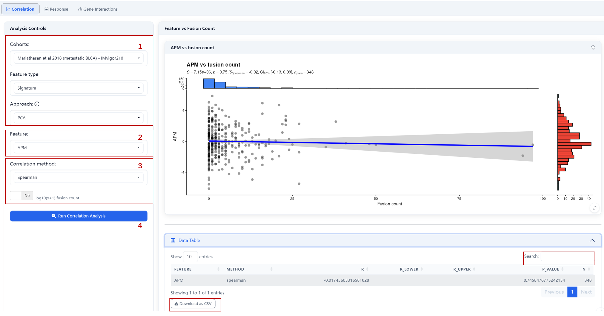{#fig-flow width=100%}
**Steps:**

1. Select target cohort, feature type (Signature/ TME), analysis approach (e.g., PCA);
2. Select specific feature (e.g., APM);
3. Select correlation method (e.g., Spearman) and choose whether to apply log10(x+1) transformation to fusion count;
4. Click Run Correlation Analysis.

**Outputs:**

- Scatter plot: shows relationship between feature scores and fusion count with fitted trend line;
- Statistics: Spearman correlation coefficient (ρ), 95% CI, and p-value.

### Response

Evaluate associations between fusion status and clinical response, reported as two complementary analyses:

- **Binary response (Response2: pre-treatment Pre-R vs Pre-NR)**: uses the harmonised `Response2` variable restricted to pre-treatment samples (`Pre-R` vs `Pre-NR`). The heading and analysis explicitly state this restriction. The reported odds ratio is the response odds ratio for Fusion+ vs Fusion- samples: OR > 1 means higher response odds in Fusion+ samples.
- **RECIST response**: only samples with RECIST-coded values (`CR`, `PR`, `SD`, `PD`) are analysed; `CR`/`PR` are responders and `SD`/`PD` are non-responders. NE and non-RECIST labels (e.g., `R`/`NR`, `CB`/`NCB`, `Responder`/`Non-responders`) are excluded and reported as unevaluable; use the binary analysis for those cohorts. If only one RECIST class remains, the panel says so instead of reporting a misleading 0/NA test.

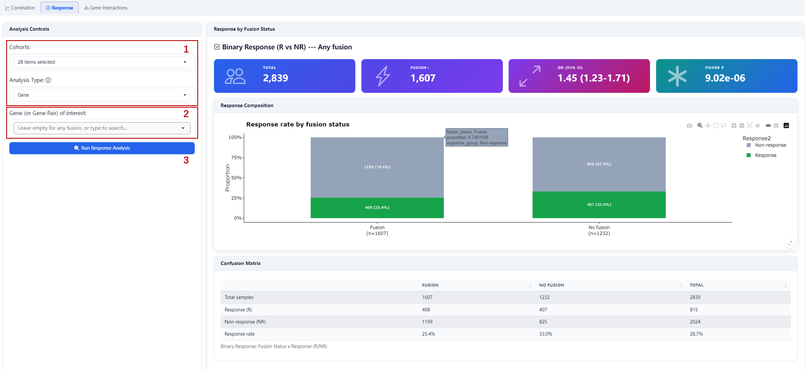{#fig-flow width=100%}

**Steps:**

1. Select one or multiple cohorts and analysis type (Gene/ Gene Pair);
2. Enter target gene/gene pair(s) (leave empty to use any fusion as Fusion+);
3. Click Run Response Analysis.

**Outputs:**

- **Binary response**: response-rate composition, confusion matrix, response odds ratio (Fusion+ vs Fusion-) with 95% CI, and Fisher's exact test p-value for pre-treatment `Pre-R` vs `Pre-NR`;
- **RECIST response**: response composition and contingency table for RECIST-coded samples only, with Fisher's exact p-value; non-RECIST/NE records are excluded and the exclusion rule is shown in the panel.

### Gene Co-occurrence

Detect statistical co-occurrence or mutual exclusivity between gene-fusion events across patients. This is an association test, not evidence of physical or functional gene–gene interaction.

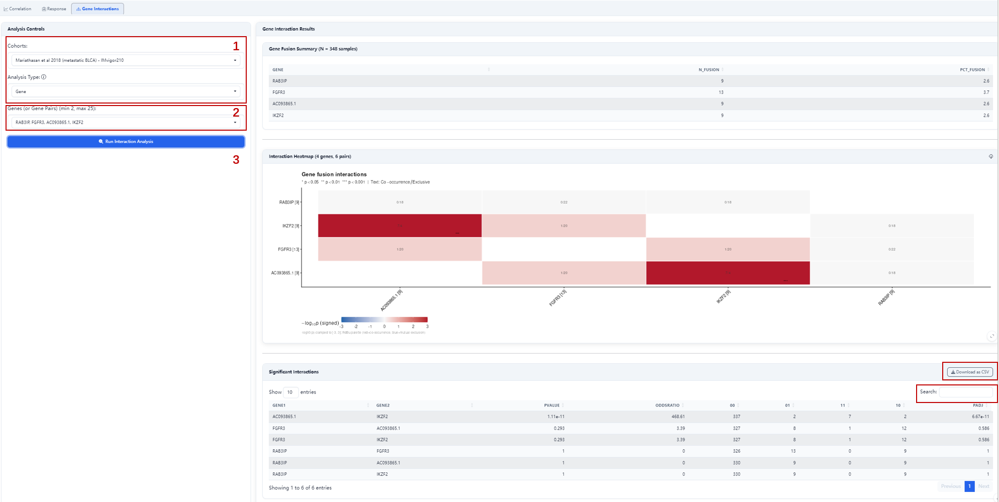{#fig-flow width=100%}
**Steps:**

1. Select target cohort and analysis type (Gene / Gene Pair);
2. Enter target genes/gene pairs (min 2, max 25);
3. Click Run Co-occurrence Analysis.

**Outputs:**

- Co-occurrence/mutual exclusivity heatmap: shows association patterns between gene pairs; stars are based on raw p-values, while the table reports FDR-adjusted values;
- Significant Co-occurrences table and CSV: only pairs with FDR < 0.05 (the header reports how many of all pairs are significant);
- Statistics: raw p-values, odds ratios (OR), and FDR-adjusted p-values for each gene pair.

## Survival (KM)

Evaluate the association between gene fusion status and patient survival by generating and comparing Kaplan-Meier survival curves between Fusion+ and Fusion− groups. The analysis unit is the **patient**: multi-sample patients contribute one record, and a fusion on any sample marks the patient as Fusion+. When a patient has multiple clinical records, record selection prioritizes an event for the endpoint being analysed and then longer follow-up for that endpoint, so an OS event cannot displace a PFS progression record. Survival time units are inferred from each cohort's data rather than assumed from cohort type: months are used only when both the median and maximum observed OS time are below 150; otherwise the day scale is used.

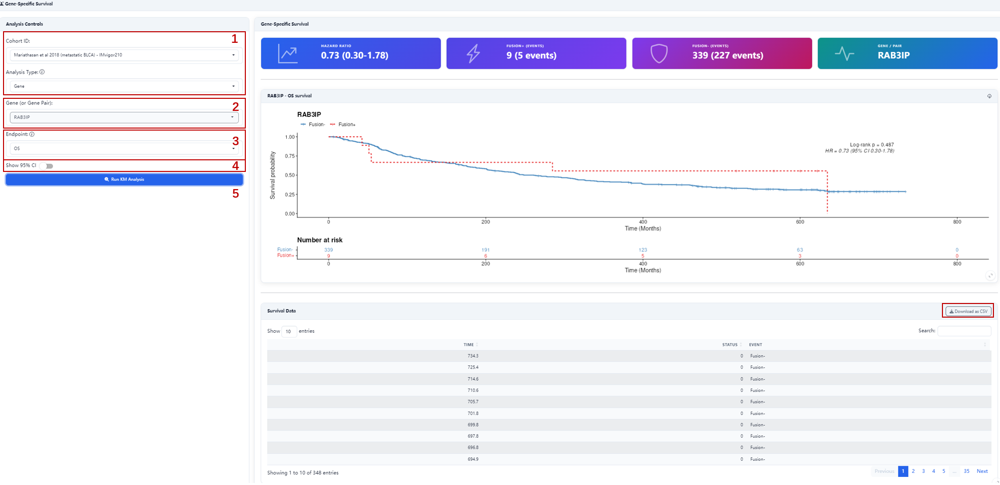{#fig-flow width=100%}
**Steps:**

1. Select target cohort and analysis type (Gene / Gene Pair);
2. Enter target gene/gene pair name (defines Fusion+ vs Fusion− grouping);
3. Select survival endpoint (e.g., OS);
4. Optional: check Show 95% CI to display confidence intervals;
5. Click Run KM Analysis.

**Outputs:**

- KM survival curves: show survival probability over time for both groups;
- Log-rank test p-value: indicates whether survival curves differ significantly;
- Hazard ratio (HR) with 95% confidence interval. If one group has zero events, the HR is reported as not estimable while the KM curves and log-rank test are still shown;
- Survival data table: includes time and event status; supports search and pagination.

## Cox Regression

Evaluate the independent prognostic value of gene fusions using multivariable Cox proportional hazards regression, with optional adjustment for clinical covariates. The analysis unit is the **patient**, consistent with the KM analysis. Genes with fewer than two fusion-positive patients are dropped with a visible warning rather than modelled silently; FDR-adjusted values are used consistently in the table, forest-plot colors, and CSV export.

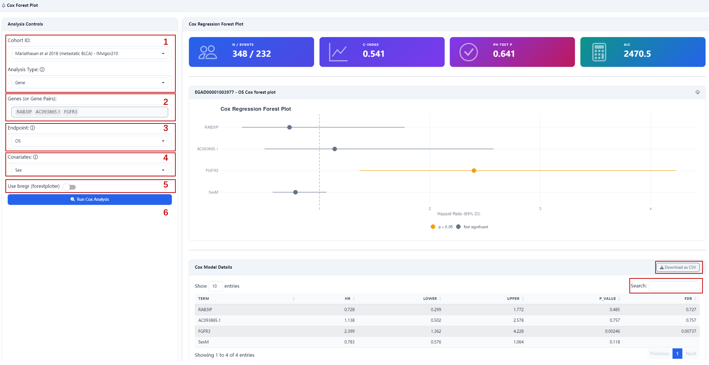{#fig-flow width=100%}
**Steps:**

1. Select target cohort and analysis type (Gene / Gene Pair);
2. Select target gene/gene pair names (multiple allowed);
3. Select survival endpoint (e.g., OS);
4. Select clinical covariates (e.g., Sex);
5. Optional: check Use breg (forestplotter) to enable the dedicated forest plot rendering engine.
6. Click Run Cox Analysis.

**Outputs:**

- Forest plot: displays hazard ratios (HR) and 95% CI for each fusion gene and covariate;
- Model summary statistics:
  - C-index: model discriminative ability (0.5 = random, >0.7 = acceptable);
  - PH test p: proportional hazards assumption test (>0.05 indicates assumption holds);
  - AIC: model fit quality indicator;
- Detailed results table: includes HR, 95% CI, p-values, and FDR-adjusted values for each variable.

## Landscape

Visualize the fusion landscape within a single cohort as an OncoPrint. Each column represents a sample; each row represents a gene or gene pair. Colored rectangles indicate detected fusion types. The sample universe and alterations respect the active global filters, and comma-separated gene lists are expanded into individual gene pairs. Labels switch between “Genes” and “Gene Pairs” with the selected analysis level; “Samples Shown” is the number of non-empty columns, and coverage is shown relative to the analysed sample universe.

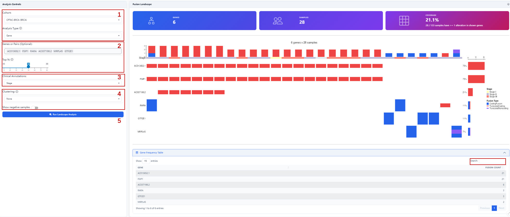{#fig-flow width=100%}

**Steps:**

1. Select target cohort and analysis type (Gene / Gene Pair);
2. Enter target gene/gene pair names (optional), or set Top N to display the top fusion-frequency genes (leave empty for auto-detection).
3. Select clinical annotation covariates (e.g., Stage) for sample-level annotation bars;
4. Optionally select a clustering method (None / Samples only / Genes only / Both axes) and toggle whether to include samples without fusions (Show negative samples).
5. Click Run Landscape Analysis.

**Outputs:**

- OncoPrint main plot: shows fusion event distribution for each gene across samples;
- Top annotation bars: display selected clinical covariates (e.g., Stage);
- Side bar: shows fusion frequency per gene;
- Bottom bar: shows total alterations per sample;
- Gene/pair frequency table: lists fusion counts for each gene or gene pair; supports search and pagination.

